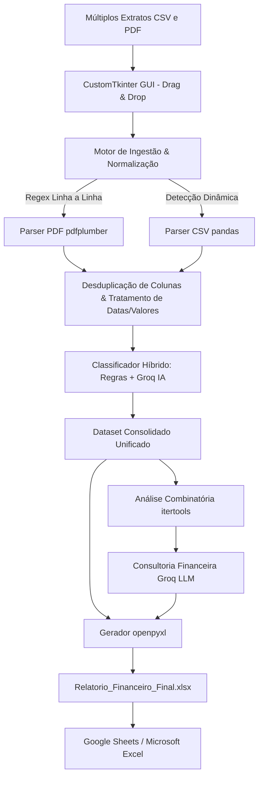

# 📊 Analisador Financeiro Multibancos (AI & Data Science)

<div align="center">


**Pipeline inteligente de Engenharia e Análise de Dados Financeiros com cruzamento multibancos, visão consolidada para Google Sheets/Excel e IA Generativa.**

</div>

---

## 📌 Sobre o Projeto

O **Analisador Financeiro Multibancos** resolve um dos maiores desafios de finanças pessoais e empresariais: **a fragmentação de extratos em diferentes bancos e formatos**.

Em vez de organizar planilhas manualmente ou alimentar ferramentas proprietárias, esta aplicação permite que você simplesmente **arraste e solte múltiplos extratos bancários (arquivos CSV e PDF)** de qualquer banco brasileiro (Banco Inter, C6 Bank, Nubank, Itaú, Bradesco, Banco do Brasil, Santander, Caixa, etc.).

O sistema normaliza os dados, realiza o **cruzamento das contas bancárias**, aplica **análise combinatória matemática** para identificar cenários ótimos de economia e consulta um modelo de IA da **Groq** para gerar um diagnóstico financeiro estratégico completo.

Ao final, gera uma planilha profissional (`Relatorio_Financeiro_Final.xlsx`) com **Dashboard interativo e gráficos nativos**, 100% pronta para ser aberta no **Google Sheets** ou no **Microsoft Excel**.

---

## 🚀 Principais Funcionalidades

- 🖥️ **Interface Gráfica Moderna (CustomTkinter):**
  - Tema escuro/claro (*Dark/Light mode*) com cantos arredondados, visual contemporâneo e alternância em tempo real.
  - Suporte completo a **Drag & Drop** para múltiplos arquivos simultâneos.
  - Barra de progresso animada e abas separadas para logs em tempo real, relatório da IA e ações rápidas.
  - Botão integrado para abrir a planilha diretamente no Excel/Sheets após o processamento.
- 🏦 **Suporte Multibancos & Multiformatos:**
  - Extração inteligente de **CSVs** com detecção dinâmica de delimitadores e linhas de cabeçalho.
  - Parser de alta precisão para extratos em **PDF** (tratando quebras de linha, desconsiderando linhas de saldo diário e inferindo anos ausentes).
  - Reconhecimento automático da instituição de origem (ex.: *Banco Inter*, *C6 Bank*, *Nubank*).
- 🔀 **Cruzamento Consolidado de Dados:** Unifica todas as transações cronologicamente e gera comparações de receitas versus despesas por instituição financeira.
- ⚡ **Classificador Híbrido de Despesas:**
  - **Motor heurístico instantâneo:** Mapeia gastos recorrentes em milissegundos (*Uber, Mercado, Farmácia, B3/CDB, Contas de Consumo*).
  - **IA com Groq:** Categoriza transações atípicas em lotes indexados ultracompactos, respeitando limites de taxa de tokens (OTPM).
- 🧮 **Análise Combinatória Aplicada (`itertools`):** Simula matematicamente todas as combinações de corte em categorias não essenciais, apontando os cenários mais impactantes para o orçamento.
- 💡 **Consultor Financeiro de IA (Groq):** Análise executiva gerada por LLM com diagnóstico de fluxo de caixa, gargalos invisíveis e plano prático de ação.
- 📊 **Dashboard Executivo Nativo (Excel & Google Sheets):**
  - Cartões de KPI formatados (Total de Receitas, Total de Despesas e Saldo Líquido).
  - **Gráficos Nativos:** Barras por Categoria, Pizza de Distribuição, Gráfico Comparativo entre Bancos e Evolução Mensal.
  - Abas detalhadas de *Transações Consolidadas*, *Resumo por Categoria* e *Insights da IA*.

---

## 🏗️ Arquitetura do Pipeline



---

## 📁 Estrutura do Repositório

```text
finpy/
├── analisador_financeiro.py    # Aplicação principal (CustomTkinter GUI + Pipeline + IA + Excel)
├── dados_exemplo.csv           # Amostra de extrato para teste imediato (Conta 1)
├── dados_exemplo_banco2.csv    # Amostra de extrato para teste de cruzamento (Conta 2)
├── .env.example                # Modelo para configuração da API Key
├── .gitignore                  # Proteção contra commit de extratos pessoais e chaves
├── requirements.txt            # Dependências Python do projeto
└── README.md                   # Documentação completa
```

---

## 🛠️ Tecnologias e Bibliotecas

- **Linguagem:** Python 3.10+
- **Interface Visual:** [CustomTkinter](https://github.com/TomSchimansky/CustomTkinter) + [tkinterdnd2](https://github.com/pmgagne/tkinterdnd2)
- **Processamento de Dados:** [Pandas](https://pandas.pydata.org/)
- **Extração de Documentos:** [pdfplumber](https://github.com/jsvine/pdfplumber)
- **Inteligência Artificial:** [Groq Cloud SDK](https://console.groq.com/)
- **Matemática & Otimização:** `itertools` (Biblioteca padrão)
- **Construção de Planilhas & Gráficos:** [openpyxl](https://openpyxl.readthedocs.io/)

---

## ⚙️ Como Instalar e Executar

### 1. Clonar o Repositório
```bash
git clone https://github.com/seu-usuario/finpy.git
cd finpy
```

### 2. Criar e Ativar o Ambiente Virtual
```bash
# Linux / macOS
python3 -m venv venv
source venv/bin/activate

# Windows
python -m venv venv
venv\Scripts\activate
```

### 3. Instalar Dependências
```bash
pip install -r requirements.txt
```

### 4. Configurar a Chave de API do Groq
1. Obtenha uma chave gratuita em [console.groq.com](https://console.groq.com/keys).
2. Crie seu arquivo `.env` a partir do modelo:
```bash
cp .env.example .env
```
3. Edite o arquivo `.env` inserindo sua chave:
```env
GROQ_API_KEY=gsk_sua_chave_aqui
```
*(Caso não defina no `.env`, a própria interface gráfica solicitará a chave ao iniciar o processamento).*

### 5. Executar a Aplicação
```bash
python analisador_financeiro.py
```

---

## 🧪 Testando com os Dados de Exemplo

Para testar o aplicativo sem precisar de extratos reais imediatamente:
1. Abra a aplicação.
2. Arraste para a janela os arquivos `dados_exemplo.csv` e `dados_exemplo_banco2.csv`.
3. Clique em **"🚀 Executar Cruzamento & Análise Completa"**.
4. O arquivo `Relatorio_Financeiro_Final.xlsx` será gerado automaticamente.

---

## 🔒 Segurança e Privacidade de Dados

Este projeto foi construído respeitando as melhores práticas de privacidade financeira:
- O arquivo `.gitignore` vem pré-configurado para **nunca enviar arquivos `.env`, extratos pessoais (`*.csv`, `*.pdf`) ou planilhas geradas (`*.xlsx`)** para o repositório Git.
- Todos os dados permanecem locais na sua máquina, sendo transmitidos ao Groq apenas os nomes das descrições de despesas para fins de categorização e os totais consolidados para a geração do diagnóstico textual.

---

## 📜 Licença

Distribuído sob a licença MIT. Consulte `LICENSE` para mais detalhes.
