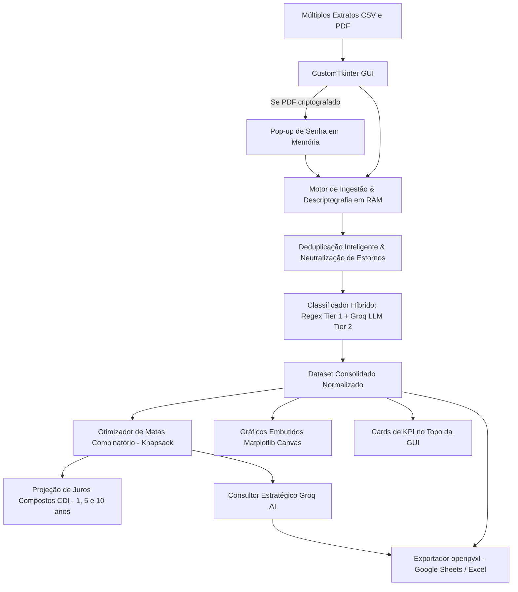

# 📊 FinPy • Analisador Financeiro Multibancos (AI & Data Science)

<div align="center">


**Pipeline completo de Engenharia de Dados, Otimizador de Metas Combinatório (Knapsack Problem), Projeção de Juros Compostos (CDI), Deduplicação Inteligente, Extrator de PDF com Senha em Memória, Interface Executiva com Cards de KPI e Dashboards Embutidos.**

</div>

---

## 📌 Visão Geral do Projeto

O **FinPy** é uma solução de engenharia e ciência de dados voltada para resolver a fragmentação e complexidade na consolidação de extratos bancários de múltiplas instituições financeiras (Banco Inter, C6 Bank, Nubank, Itaú, Bradesco, BB, Santander, Caixa, etc.).

A aplicação unifica o pipeline de dados de ponta a ponta:
1. **Ingestão Resiliente:** Processa arquivos CSV e PDFs (com ou sem senha), descriptografando diretamente em memória para garantir segurança e conformidade de dados.
2. **Deduplicação & Higienização:** Remove duplicatas acidentais e cancela estornos/reversões de compras para não inflar receitas e despesas.
3. **Classificação Híbrida (Regex + LLM):** Regras de alta performance mapeiam despesas imediatas, acionando a API do Groq apenas para lançamentos atípicos (economia de tokens e execução ultrarrápida).
4. **Matemática Financeira & Análise Combinatória:** Modela o corte de despesas supérfluas como uma variação do **Problema da Mochila (Knapsack / Subset Sum)**, encontrando a combinação exata de cortes para bater a meta estipulada pelo usuário com o menor atrito perceptual no estilo de vida.
5. **Projeções de Juros Compostos:** Simula o impacto multiplicador de aportar o valor economizado a 100% do CDI nos horizontes de 1, 5 e 10 anos.
6. **Interface Gráfica Executiva (CustomTkinter + Matplotlib):** Exibe Cards de KPI no topo, renderiza gráficos nativos embutidos (Rosca de Despesas, Fluxo Temporal e Curva de Juros) e gera planilhas profissionais para **Google Sheets** e **Excel**.

---

## 🚀 Os 4 Pilares da Aplicação

### 1. Engenharia de Dados & Pipeline
- **Extrator Automático de PDF (com ou sem senha):** 
  - Lê e extrai transações de extratos em PDF com alta precisão via `pdfplumber` e `pypdf`.
  - Caso o PDF possua senha de proteção, a interface exibe um pop-up discreto solicitando a chave. A descriptografia ocorre **100% em memória**, sem jamais salvar arquivos intermediários desprotegidos em disco.
- **Classificador Híbrido de Transações (Regex Tier 1 + Fallback LLM Tier 2):**
  - **Tier 1 (Regex compilado):** Regras em $O(1)$ identificam instantaneamente padrões bancários comuns (*Uber, 99, iFood, Restaurantes, Drogarias, Assinaturas, Mercados, etc.*).
  - **Tier 2 (Groq LLM Fallback):** Transações desconhecidas são enviadas em lotes compactos para a API do Groq classificar, reduzindo custos de API e acelerando a execução em mais de 90%.
- **Deduplicação Inteligente & Tratamento de Estornos:**
  - Elimina lançamentos duplicados gerados por importação acidental do mesmo extrato ou períodos sobrepostos.
  - Detecta pares de compras seguidas de estorno/cancelamento (valores opostos de mesma quantia com descrições correspondentes no mesmo período) e neutraliza ambos, impedindo contaminação da base histórica.

### 2. Matemática Financeira & Análise Combinatória Avançada
- **Otimizador de Metas (Knapsack Problem / Subset Sum):**
  - O usuário define sua meta mensal de economia (ex.: `R$ 450,00/mês`).
  - O algoritmo modela as categorias não essenciais como itens de uma mochila:
    $$\sum_{i \in S} v_i \ge \text{Meta}$$
  - Minimiza a função de impacto e atrito:
    $$F(S) = \alpha \cdot (\sum v_i - \text{Meta}) + \beta \cdot |S| + \gamma \cdot \sum w_i$$
    onde $|S|$ penaliza a quantidade de categorias sacrificadas (menos categorias cortadas = menor mudança de hábitos) e $w_i$ avalia o atrito subjetivo (cortar Assinaturas ou Delivery tem menor impacto que cortar Restaurante ou Compras).
  - Gera cenários claros: *Plano Otimizado (Menor Impacto)*, *Plano Equilibrado* e *Plano Agressivo (Máxima Poupança)*.
- **Projeção de Juros Compostos (CDI):**
  - Calcula o valor futuro de aportes mensais recorrentes no final de cada período:
    $$FV(n) = PMT \times \frac{(1 + i)^n - 1}{i}$$
  - Exibe o retorno projetado e os juros acumulados em **1 ano (12 meses)**, **5 anos (60 meses)** e **10 anos (120 meses)** a uma taxa real parametrizada (~0.85% ao mês, equivalente a 100% do CDI atual líquido).

### 3. Interface & Experiência Visual (GUI)
- **Cards de KPI no Topo:**
  - 💰 **Total de Entradas** (Receitas consolidadas formatadas em verde).
  - 💸 **Total de Saídas** (Despesas operacionais em vermelho).
  - 📈 **Taxa de Poupança (%)** (Percentual de sobra líquida sobre as entradas).
  - 🚨 **Maior Ralo Financeiro** (Identificação da categoria mais custosa e seu valor).
- **Gráficos Embutidos na Janela (Matplotlib + CTk):**
  - Aba nativa com Canvas Matplotlib de alta resolução estilizado em tema escuro:
    - **Gráfico de Rosca (Donut):** Distribuição percentual das maiores despesas.
    - **Fluxo de Caixa Mensal:** Barras comparativas de Entradas vs Saídas ao longo do tempo.
    - **Curva de Juros Compostos:** Gráfico comparativo entre Total Aportado e Montante Acumulado com juros do CDI.
- **Resolução de Compatibilidade Linux & Scroll Suave:**
  - Implementação de monkey-patch no CustomTkinter prevenindo o erro `AttributeError: 'str' object has no attribute 'master'` durante o uso da roda do mouse em distribuições Linux.
  - Suporte a tela cheia (`F11`), maximização responsiva e alternância dinâmica de tema (*Dark/Light*).

### 4. Portfólio & Boas Práticas (GitHub Ready)
- **Testes Automatizados com `pytest`:**
  - Suite de testes unitários em `tests/test_analisador.py` com cobertura completa: normalização de moedas, regex de transações, deduplicação de estornos, otimizador Knapsack e cálculo de juros compostos.
- **Containerização com Docker & Docker Compose:**
  - `Dockerfile` configurado com base leve `python:3.11-slim`, bibliotecas gráficas do X11/Tkinter e dependências otimizadas.
  - `docker-compose.yml` para execução rápida de testes ou da aplicação em ambientes isolados.

---

## 🏗️ Arquitetura do Pipeline



---

## 📁 Estrutura do Repositório

```text
finpy/
├── analisador_financeiro.py    # Aplicação principal (GUI, Pipeline, Knapsack, CDI, IA, Excel)
├── tests/
│   └── test_analisador.py      # Testes unitários automatizados com pytest (100% passing)
├── Dockerfile                  # Empacotamento Docker com dependências X11/Tkinter
├── docker-compose.yml          # Orquestração para rodar testes e aplicação
├── pytest.ini                  # Configurações do ambiente de testes
├── requirements.txt            # Dependências Python pinned
├── dados_exemplo.csv           # Extrato de exemplo (Conta 1)
├── dados_exemplo_banco2.csv    # Extrato de exemplo para cruzamento (Conta 2)
├── .env.example                # Modelo para configuração da chave Groq
├── LICENSE                     # Licença MIT
└── README.md                   # Documentação detalhada
```

---

## ⚙️ Instalação e Execução

### Opção 1: Ambiente Local (Virtualenv)

1. **Clone o repositório:**
   ```bash
   git clone https://github.com/mmelquii-dev/FinPy.git
   cd FinPy
   ```

2. **Crie e ative o ambiente virtual:**
   ```bash
   python3 -m venv venv
   source venv/bin/activate  # No Linux/Mac
   # ou: .\venv\Scripts\activate no Windows
   ```

3. **Instale as dependências:**
   ```bash
   pip install -r requirements.txt
   ```

4. **Configure a chave do Groq:**
   Copie `.env.example` para `.env` e insira sua chave gratuita da [Groq Cloud](https://console.groq.com/):
   ```env
   GROQ_API_KEY=sua_chave_aqui
   ```

5. **Execute a aplicação:**
   ```bash
   python analisador_financeiro.py
   ```

---

### Opção 2: Executando os Testes Automatizados (`pytest`)

Para rodar a suite completa de testes unitários:
```bash
pytest tests/ -v
```

Saída esperada:
```text
tests/test_analisador.py::test_limpar_valor_monetario PASSED             [ 20%]
tests/test_analisador.py::test_classificador_regex PASSED                [ 40%]
tests/test_analisador.py::test_deduplicar_e_tratar_estornos PASSED       [ 60%]
tests/test_analisador.py::test_otimizador_metas_knapsack PASSED          [ 80%]
tests/test_analisador.py::test_projecao_juros_compostos PASSED           [100%]
============================== 5 passed in 1.6s ===============================
```

---

### Opção 3: Executando com Docker

1. **Executar a suite de testes no Docker:**
   ```bash
   docker-compose run --rm test
   ```

2. **Construir a imagem da aplicação:**
   ```bash
   docker build -t finpy:latest .
   ```

---

## 📄 Licença

Este projeto é distribuído sob os termos da licença **MIT**. Veja o arquivo [LICENSE](LICENSE) para mais detalhes.

Copyright (c) 2026 Melquisedeque Silva.
